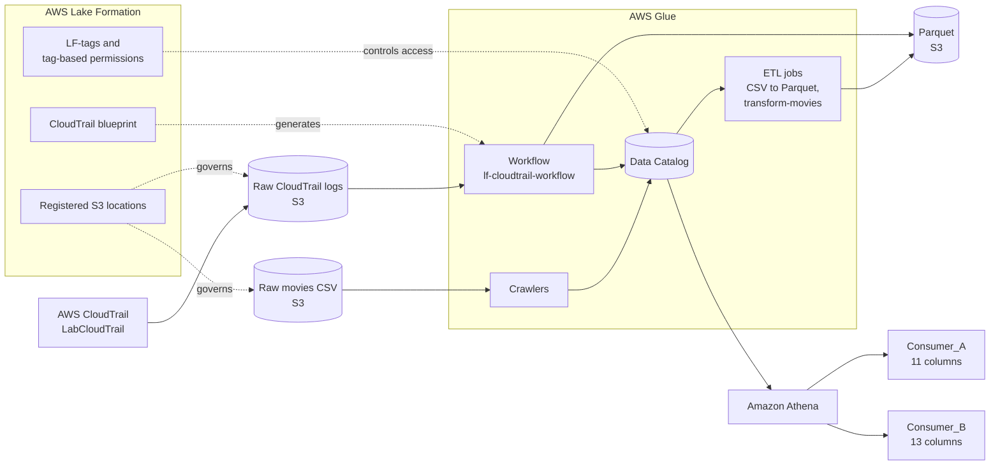

# Building Data Lakes on AWS

Hands-on write-ups of the **Building Data Lakes on AWS** lab series. Across three labs I built a data lake from scratch, automated its creation with blueprints, and then secured it as a data product with tag-based access control.

## Scenario

All three labs follow a data engineer at **AnyCompany**, a cloud marketing organization:

1. **Pilot a data lake** on movie data and prove it can be queried efficiently.
2. **Automate ingestion** of AWS CloudTrail logs so the operational analytics team can query them.
3. **Serve curated data to customers**, with standard and enterprise subscribers seeing different columns.

## Big Picture

```
Raw data in S3
   -> Lake Formation (registered locations, permissions, blueprints, LF-tags)
   -> Glue (crawlers, ETL jobs, workflows, Data Catalog)
   -> Parquet in S3
   -> Athena (SQL analytics, per-consumer views)
```

## Lab Index

| Lab | Topic | Services | Key outcome |
|---|---|---|---|
| [01](lab-01-lake-formation-data-lake/) | Build a data lake with Lake Formation | S3, Lake Formation, Glue, Athena | CSV converted to Parquet; 1002 Action movies verified; Parquet scans less data |
| [02](lab-02-lake-formation-blueprints/) | Automate data lake creation with blueprints | CloudTrail, Lake Formation, Glue Workflows, Athena | CloudTrail logs ingested as Parquet through a generated workflow |
| [03](lab-03-data-as-a-product/) | Working with data as a product | Glue, Lake Formation LF-tags, Athena | Regular users see few columns, enterprise users see all columns |

## Skills Demonstrated

- **Data lake setup:** registering S3 locations and organizing data with Lake Formation
- **Metadata management:** Glue Data Catalog databases and tables, schema discovery with crawlers
- **ETL:** Glue Visual ETL jobs, including CSV to Parquet conversion
- **Orchestration:** Glue workflows built from Lake Formation blueprints, plus a hand-built DAG of triggers, jobs, and crawlers
- **Governance and security:** Lake Formation permissions, LF-tags, and tag-based access control (LF-TBAC) with column-level restrictions
- **Analytics:** serverless SQL with Athena, and comparing query cost across file formats
- **Validation:** checking pipeline output before exposing it to consumers

## What Each Lab Covers

### Lab 01: Build a data lake
Registered an S3 location, created a database, and used a crawler to discover the schema of a movies CSV. Queried it with Athena, then converted it to Parquet with a Glue job and compared the two formats. Parquet returned the same result while scanning far less data.

### Lab 02: Automate with blueprints
Used the Lake Formation CloudTrail blueprint to generate a complete ingestion workflow (pre-crawler job, crawler, post-crawler job, ETL job, post-ETL job). Built a smaller version by hand to understand how the pieces fit, then queried the resulting Parquet table for error events.

### Lab 03: Data as a product
Validated a scheduled Glue job that maintains a processed table, then defined LF-tags (`Environment`, `Customer`, `Confidential`), applied them to a database, table, and columns, and granted tag-based permissions to two test consumers. Confirmed in Athena that each consumer sees only what their subscription allows.

## Key Learnings Across the Series

- **The Data Catalog holds metadata, not data.** Tables are definitions that point at files in S3.
- **Lake Formation governs access on top of IAM.** Explicit grants were needed before Athena or the workflow role could use a table or location.
- **Columnar formats cut cost.** Parquet scans only the columns a query needs, and Athena charges by data scanned.
- **Automation beats repetition.** Blueprints replaced the manual crawler, job, and trigger setup from Lab 1 with a few form fields.
- **Workflows make pipelines observable.** A Glue workflow is a DAG tracked as one unit, with per-node status.
- **Tags scale better than per-resource grants.** One grant per tag combination covers every matching resource, including future ones.
- **Tag logic is predictable.** Multiple keys in a grant combine with AND; multiple values for one key combine with OR.
- **Revoking `IAMAllowedPrincipals` is what makes tag rules effective.** Otherwise default IAM access bypasses them.

## Repository Structure

```
building-data-lakes-on-aws/
├── README.md
|
├── lab-01-lake-formation-data-lake/
│   ├── README.md
|
├── lab-02-lake-formation-blueprints/
│   ├── README.md
│   
├── lab-03-data-as-a-product/
│   ├── README.md
│   
└── screenshots/
    ├── lab1/
    ├── lab2/
    └── lab3/
```

